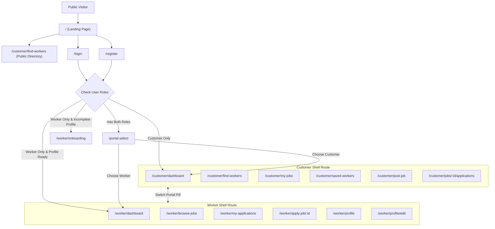

# Navigation Architecture & Routing Flow — Skill-Link 2.0

## 1. Routing Strategy

Skill-Link utilizes **GoRouter** with centralized auth-aware redirects and persistent `ShellRoute` layouts for both the Customer and Worker experiences.

---

## 2. Route Matrix

| Route Path | Access Level | Description | Destination Widget |
|---|---|---|---|
| `/` | Public | Public landing page | `LandingPage` |
| `/login` | Public (Unauthenticated) | Common login screen | `LoginScreen` |
| `/register` | Public (Unauthenticated) | Common registration screen | `RegisterScreen` |
| `/forgot-password` | Public | Password reset email form | `ForgotPasswordScreen` |
| `/portal-select` | Authenticated | EcoCollect-inspired portal choice | `PortalSelectionScreen` |
| `/role-enroll` | Authenticated | Add second role (Customer/Worker) | `RoleEnrollmentScreen` |
| `/worker/onboarding` | Authenticated (Worker) | Professional profile builder | `WorkerOnboardingScreen` |
| `/customer/dashboard` | Customer | Customer home & quick actions | `CustomerDashboardScreen` |
| `/customer/find-workers` | Public / Customer | Marketplace directory with filters | `FindWorkersScreen` |
| `/customer/workers/:id` | Public / Customer | Detailed worker public profile | `WorkerDetailScreen` |
| `/customer/my-jobs` | Customer | Customer's active/past job postings | `CustomerJobsScreen` |
| `/customer/post-job` | Customer | Job creation form | `PostJobScreen` |
| `/customer/jobs/:id` | Customer / Worker | Job detail view & status actions | `JobDetailScreen` |
| `/customer/jobs/:id/applications`| Customer (Owner) | Review applicants on a job | `JobApplicationsScreen` |
| `/customer/saved-workers` | Customer | Bookmarked worker profiles | `SavedWorkersScreen` |
| `/worker/dashboard` | Worker | Worker earnings & opportunities | `WorkerDashboardScreen` |
| `/worker/browse-jobs` | Worker | Open job discovery with filters | `BrowseJobsScreen` |
| `/worker/apply-job/:id` | Worker | Submit proposal with rate & note | `ApplyJobScreen` |
| `/worker/my-applications` | Worker | Track submitted proposals & status | `MyApplicationsScreen` |
| `/worker/profile/edit` | Worker | Edit skills, rate, bio & locality | `EditWorkerProfileScreen` |
| `/reviews/write` | Customer | Post authenticated star review | `WriteReviewScreen` |
| `/notifications` | Authenticated | In-app notification center | `NotificationsScreen` |
| `/profile` | Authenticated | Account profile & role management | `ProfileScreen` |
| `/settings` | Authenticated | Settings, security & about | `SettingsScreen` |

---

## 3. Responsive Navigation Behavior

- **Mobile Viewports (< 600px):**
  - Features an ergonomic Material 3 `NavigationBar` fixed at the bottom with 5 high-frequency destinations.
  - Landing page features a responsive right drawer (`Scaffold.endDrawer`) with quick navigation links.
- **Desktop & Tablet Viewports (>= 600px):**
  - Features a persistent `NavigationRail` alongside the main content area, keeping navigation accessible without consuming vertical viewport height.
  - Top app bar includes an instant "Switch Portal" pill button, notification bell with unread indicator, and clickable user avatar.

